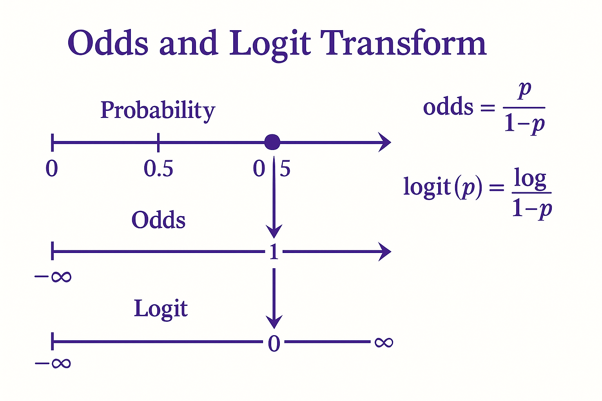
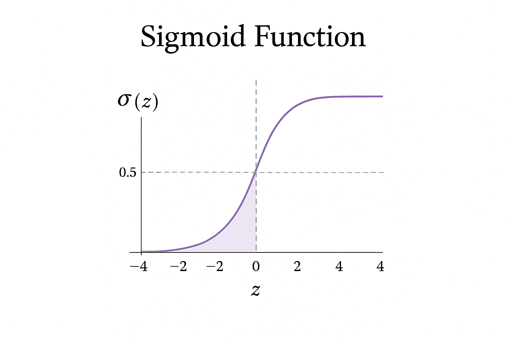
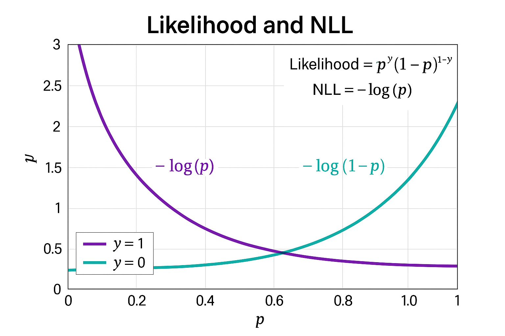
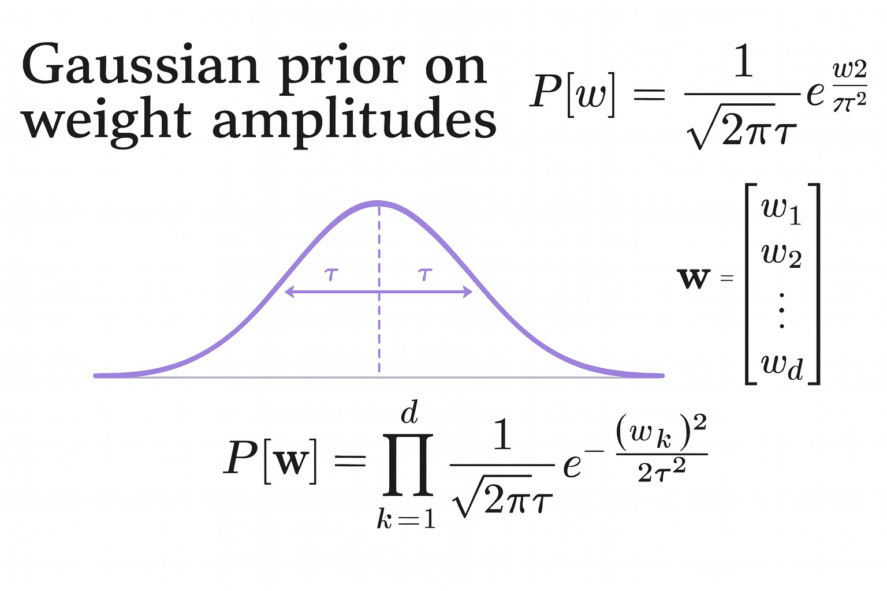
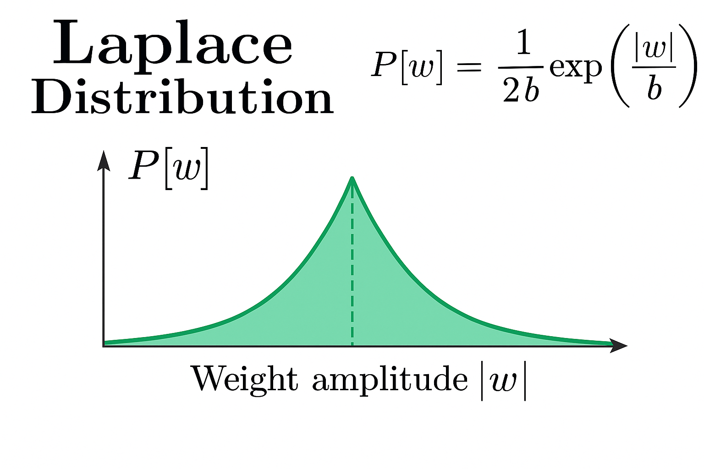

***

## From Scratch to Pro: The Complete Guide to Logistic Regression

In machine learning, it's easy to import a library, call a function like `model.fit()`, and get a result. We treat algorithms like magical black boxes. But what if we could be more than just magicians? What if we could be the engineers who *build* the box?

True mastery comes from understanding every gear and spring inside. This guide is a deep dive into one of the most fundamental algorithms in machine learning: **Logistic Regression**. We won't just learn an API. We will build it from the ground up, starting with pure logic and mathematics. We'll derive every equation, challenge our assumptions, and uncover the elegant probabilistic thinking that makes this model so powerful.

Let's begin. 🚀

---

### Part 1: Our First Hurdle - Why Linear Regression Fails for Classification

Before we can build the right tool, we have to understand why a more familiar tool, Linear Regression, just won't work for our task.

Our goal is simple: predict a **binary outcome**. Is this email spam (1) or not (0)? Will this customer churn (1) or not (0)? A natural first thought might be to use Linear Regression, which models an output as a weighted sum of inputs:

$$y = w_0 + w_1x_1 + \dots + w_nx_n = \mathbf{w}^T\mathbf{x}$$

This works beautifully for predicting continuous values like house prices. But for a yes/no classification task, it hits two fatal roadblocks.

1.  **The Output Range Problem:** Think about what we're trying to predict. We want a **probability**—a number that must, by definition, be between 0 and 1. A linear model, however, has no boundaries. Its output can be anything from $-\infty$ to $+\infty$. What would it even mean to predict a "probability" of 1.7 or -0.4? It's mathematical nonsense. We need our output to be constrained to the $[0, 1]$ interval.

2.  **The Error Assumption Problem:** At its core, Linear Regression assumes the errors (the difference between the predicted and actual values) follow a Normal (Gaussian) distribution. This makes sense when errors can be small or large in either direction. But our actual outcome is *always* either 0 or 1. The error can't be normally distributed around a fixed point; it's binary.

The verdict is clear: Linear Regression is the wrong tool for the job. We need a new approach. We need a function that can take the unbounded output of our linear equation, $\mathbf{w}^T\mathbf{x}$, and elegantly squeeze it into the $[0, 1]$ probability space we need.

---

### Part 2: A Clever Detour - Thinking in Odds

So, we have a problem. Our linear model `z = w^T x` spits out numbers from negative to positive infinity, but we need a probability `p` between 0 and 1. How do we bridge this gap?

Let's start by looking at our target, probability, in a different way. Instead of talking about the probability `p` of an event happening, let's talk about the **odds**.

$$\text{Odds} = \frac{p}{1-p} = \frac{\text{probability of event happening}}{\text{probability of event not happening}}$$

This simple transformation is our first step. Let's see what it does to our range:
* If `p` approaches 0 (the event is impossible), the Odds approach $\frac{0}{1} = 0$.
* If `p = 0.5` (a 50/50 chance), the Odds are $\frac{0.5}{0.5} = 1$.
* If `p` approaches 1 (the event is certain), the Odds approach $\frac{1}{0} = +\infty$.

This is progress! By switching from probability to odds, we've transformed our target range from `[0, 1]` to `[0, +∞)`. We've solved half of our problem by removing the upper bound of 1. But our linear model can still output negative values, and our odds can't. We're not there yet.

---

### Part 3: The "Aha!" Moment - The Logit Transformation

Let's recap. Our linear model lives in $(-\infty, +\infty)$. Our odds live in $[0, +\infty)$. The final piece of the puzzle is finding a function that can map $[0, +\infty)$ to $(-\infty, +\infty)$.

What function does that? The **logarithm**! 💡

By taking the natural log of the odds, we create what is known as the **log-odds** or the **logit function**.

$$\text{logit}(p) = \log\left(\frac{p}{1-p}\right)$$

Let's check the range one last time:
* As `p` → 0, the Odds → 0, and `log(Odds)` → $-\infty$.
* As `p` → 1, the Odds → $+\infty$, and `log(Odds)` → $+\infty$.

This is the magic moment. We have finally found a transformation of our probability `p` that has the exact same range, $(-\infty, +\infty)$, as our linear model. This allows us to make the single most important assumption in Logistic Regression:

The **log-odds** of the event is a linear function of the features.

$$\log\left(\frac{p}{1-p}\right) = w_0 + w_1x_1 + \dots + w_nx_n = \mathbf{w}^T\mathbf{x}$$

We have successfully linked our familiar linear equation to our binary classification goal.

---

### Part 4: Unwinding the Math - Deriving the Sigmoid Function

Our model is now set up to predict the log-odds of an event. That’s great for the model, but humans want a simple probability. Our job now is to take our core equation and solve it for `p`. This means we need to invert the logit function.

Let's perform this crucial derivation step-by-step, letting $z = \mathbf{w}^T\mathbf{x}$ for simplicity.

1.  **Start with the core equation:**
    $$\log\left(\frac{p}{1-p}\right) = z$$

2.  **Exponentiate both sides** to eliminate the logarithm.
    $$e^{\log\left(\frac{p}{1-p}\right)} = e^z \implies \frac{p}{1-p} = e^z$$

3.  **Multiply by `(1-p)`** to get `p` out of the denominator.
    $$p = e^z (1-p)$$

4.  **Distribute `e^z`** on the right side.
    $$p = e^z - p \cdot e^z$$

5.  **Group all terms containing `p`** on one side.
    $$p + p \cdot e^z = e^z$$

6.  **Factor out `p`**.
    $$p(1 + e^z) = e^z$$

7.  **Isolate `p`** by dividing.
    $$p = \frac{e^z}{1 + e^z}$$

This function, which takes any real-valued number `z` and squashes it into a (0, 1) range, is the celebrated **Sigmoid function**, often denoted as $\sigma(z)$. For a cleaner look, we can divide the numerator and denominator by $e^z$:

$$p = \frac{e^z/e^z}{(1+e^z)/e^z} = \frac{1}{1/e^z + e^z/e^z} = \frac{1}{1 + e^{-z}}$$

And there it is. Our final model for the probability is:
$$P(y=1|\mathbf{x}) = p = \sigma(\mathbf{w}^T\mathbf{x}) = \frac{1}{1 + e^{-\mathbf{w}^T\mathbf{x}}}$$
This beautiful S-shaped function is the heart of Logistic Regression.

---

### Part 5: Finding a Teacher - The Quest for a Loss Function

We've built a model that can make predictions. Now, how do we *train* it? How does the model learn from its mistakes? We need a **loss function**—a way to measure how "wrong" our predictions are.

Let's explore some intuitive ideas and see why this is trickier than it seems.

#### Candidate 1: Zero-One Loss (The Obvious Choice)

This is the most direct measure. Did we get it right or wrong? If we round our probability (e.g., predict 1 if $p > 0.5$, else 0), the loss is simply:
* 0 if the prediction is correct.
* 1 if the prediction is incorrect.

While this measures what we ultimately care about (accuracy), it's a disaster for training. Why? **It's not differentiable.** Imagine a graph of this loss. It's a vast, flat landscape at a value of 0 or 1, with a sudden cliff at the decision boundary. An optimizer like Gradient Descent needs a smooth slope to follow downhill to find the minimum loss. On a flat surface, the gradient is zero everywhere. The model gets no information, no direction on how to improve. A wildly wrong answer ($p=0.99$ for a true label of 0) is punished exactly the same as a barely wrong one ($p=0.51$). Learning is impossible.

#### Candidate 2: Mean Squared Error (The Borrowed Choice)

Okay, let's borrow the smooth, differentiable loss function from linear regression. It seems promising.

$$\text{Loss}_{MSE} = \sum_{i=1}^{n} (p_i - y_i)^2$$

This also fails, for a more subtle reason. When we plug our sigmoid function $p_i = \sigma(z_i)$ into this equation, the resulting loss surface becomes **non-convex**. This means it's riddled with many local minima—little valleys where our optimizer can get stuck, thinking it has found the best solution when a much better one exists elsewhere.

Even worse, think about what happens when the model is very confident and very wrong (e.g., the true label $y_i=1$ but our prediction $p_i \to 0$). At the extremes, the sigmoid function is nearly flat. This flatness causes the gradient to become tiny (a "vanishing gradient"). So, the model learns *extremely slowly* from its biggest mistakes. This is the exact opposite of what we want! We need a loss function that screams at the model when it's confidently wrong.

---

### Part 6: The Right Tool for the Job - Maximum Likelihood Estimation

Our intuitive attempts have failed. We need to turn to a more principled approach from statistics: **Maximum Likelihood Estimation (MLE)**.

The idea behind MLE is brilliant in its simplicity: **Let's find the model parameters (`w`) that make our observed data the most probable.** Instead of asking "How wrong is our model?", we ask "Which model parameters would make the data we already have look most likely?"

For a single data point $(\mathbf{x}_i, y_i)$, where $y_i \in \{0, 1\}$, the probability of observing that specific label is given by the Bernoulli distribution. We can write this in a clever, compact form:

$$P(y_i|\mathbf{x}_i; \mathbf{w}) = p_i^{y_i} (1-p_i)^{1-y_i}$$

Let's check it. If the true label $y_i=1$, the formula becomes $p_i^1(1-p_i)^0 = p_i$. If the true label $y_i=0$, it becomes $p_i^0(1-p_i)^1 = 1-p_i$. It works perfectly.

Assuming our data points are independent, the total probability (the **likelihood**) of observing our entire dataset is the product of these individual probabilities:

$$L(\mathbf{w}) = \prod_{i=1}^{n} p_i^{y_i} (1-p_i)^{1-y_i}$$

Our goal is to maximize this likelihood. However, multiplying many small probabilities is numerically unstable (it can lead to underflow). The solution is to work with the **log-likelihood**. Since the logarithm is a monotonically increasing function, maximizing the log-likelihood is the same as maximizing the likelihood itself.

$$\log L(\mathbf{w}) = \log\left(\prod_{i=1}^{n} p_i^{y_i} (1-p_i)^{1-y_i}\right) = \sum_{i=1}^{n} \log\left(p_i^{y_i} (1-p_i)^{1-y_i}\right)$$
$$\log L(\mathbf{w}) = \sum_{i=1}^{n} [y_i \log(p_i) + (1-y_i)\log(1-p_i)]$$

By convention, optimization algorithms are designed to *minimize* a function. So, we define our Loss Function as the **Negative Log-Likelihood (NLL)**. This is also known as the **Binary Cross-Entropy Loss**.

$$\text{Loss}(\mathbf{w}) = -\log L(\mathbf{w}) = - \sum_{i=1}^{n} [y_i \log(p_i) + (1-y_i)\log(1-p_i)]$$

This is the loss function we were searching for. It is convex and has a powerful probabilistic justification. And best of all, it punishes bad predictions harshly. If the true label is $y_i=1$ but our prediction $p_i \to 0$, the term $\log(p_i)$ goes to $-\infty$, and the loss skyrockets to $+\infty$. This is the "scream" we needed to jolt our model into learning from its biggest mistakes.

---

### Part 7: Finding the Downhill Path - Deriving the Gradient

We have our mountain (the loss function). Now we need a map to find the fastest way to the bottom (the minimum loss). That map is the **gradient**—the derivative of the loss with respect to our model's weights.

Let's derive this for a single data point $(x, y)$, using the chain rule. It's a beautiful cascade of derivatives.

$$\frac{\partial L}{\partial w_j} = \frac{\partial L}{\partial p} \cdot \frac{\partial p}{\partial z} \cdot \frac{\partial z}{\partial w_j}$$

1.  **Derivative of Loss w.r.t. Probability ($\frac{\partial L}{\partial p}$):**
    $$L = -[y \log p + (1-y)\log(1-p)]$$
    $$\frac{\partial L}{\partial p} = -\left[\frac{y}{p} + (1-y)\frac{-1}{1-p}\right] = -\left[\frac{y(1-p) - p(1-y)}{p(1-p)}\right] = -\left[\frac{y-yp-p+yp}{p(1-p)}\right] = \frac{p-y}{p(1-p)}$$

2.  **Derivative of Probability w.r.t. Logit ($\frac{\partial p}{\partial z}$):** This is the derivative of the sigmoid function, $p = \sigma(z)$. It has a famous and beautiful result.
    $$p = \frac{1}{1+e^{-z}} = (1+e^{-z})^{-1}$$
    $$\frac{\partial p}{\partial z} = -1 \cdot (1+e^{-z})^{-2} \cdot (e^{-z} \cdot -1) = \frac{e^{-z}}{(1+e^{-z})^2}$$
    Now for a lovely algebraic simplification:
    $$\frac{\partial p}{\partial z} = \frac{1}{1+e^{-z}} \cdot \frac{e^{-z}}{1+e^{-z}} = p \cdot \frac{(1+e^{-z})-1}{1+e^{-z}} = p \cdot \left(1 - \frac{1}{1+e^{-z}}\right) = p(1-p)$$
    The derivative of the sigmoid is simply `sigmoid(z) * (1 - sigmoid(z))`!

3.  **Derivative of Logit w.r.t. Weight ($\frac{\partial z}{\partial w_j}$):**
    $$z = w_0x_0 + w_1x_1 + \dots + w_jx_j + \dots$$
    $$\frac{\partial z}{\partial w_j} = x_j$$

4.  **Putting It All Together:**
    $$\frac{\partial L}{\partial w_j} = \left(\frac{p-y}{p(1-p)}\right) \cdot \left(p(1-p)\right) \cdot (x_j)$$

The $p(1-p)$ terms cancel out perfectly, leaving us with an astonishingly simple and elegant result:

$$\frac{\partial L}{\partial w_j} = (p-y)x_j$$

This is incredible. The gradient for a specific weight is just the **prediction error (`p-y`) multiplied by the corresponding input feature (`x_j`)**. It's intuitive, computationally efficient, and forms the basis for how our model learns.

---

### Part 8: The Art of Discipline - A Deep Dive into Regularization

So far, our model has one mission: get the loss on the training data as low as possible. This sounds good, but it can lead to a dangerous problem called **overfitting**. An overfit model is like a student who memorizes the answers to a practice test but hasn't learned the actual concepts. It performs perfectly on data it's already seen but fails miserably on new, unseen data.

**Regularization** is our defense. It's a technique to prevent overfitting by adding a penalty for model complexity to our loss function. The most profound way to understand this is to see regularization as the mathematical expression of our prior beliefs about how the model's weights *should* behave. This is formalized in the **Maximum A Posteriori (MAP)** framework.

$$\text{Loss}_{MAP} = \underbrace{-\log(P(\text{Data}|\mathbf{w}))}_{\text{Cross-Entropy Loss}} \underbrace{-\log(P(\mathbf{w}))}_{\text{Regularization Penalty}}$$

The magic happens when we choose a specific mathematical form for our prior belief, $P(\mathbf{w})$.

#### L2 Regularization (Ridge): The Belief in Teamwork 🤝

* **The Core Belief:** You're a manager who believes in teamwork. You want everyone to contribute, but you want to prevent any single person from becoming so powerful they dominate the project. In feature terms: **most features are probably useful, but none should have an overwhelmingly large influence.**

* **The Mathematical Encoding (Gaussian Prior):** This belief is perfectly captured by assuming each weight $w_j$ follows a Gaussian (Normal) Distribution centered at zero. The classic "bell curve" says that weights are most likely to be small (close to zero), discouraging large weights but rarely forcing them to be *exactly* zero.
    $$P(w_j) = \frac{1}{\sqrt{2\pi\sigma^2}} e^{-\frac{w_j^2}{2\sigma^2}}$$

* **Deriving the L2 Penalty:** Let's derive the penalty term, $-\log(P(w_j))$:
    $$\text{Penalty} = -\log\left(\frac{1}{\sqrt{2\pi\sigma^2}} e^{-\frac{w_j^2}{2\sigma^2}}\right) = -\left[\log\left(\frac{1}{\sqrt{2\pi\sigma^2}}\right) - \frac{w_j^2}{2\sigma^2}\right] = \log(\sqrt{2\pi\sigma^2}) + \frac{1}{2\sigma^2}w_j^2$$
    When minimizing, the first term is a constant, so we drop it. We absorb the constant $1/(2\sigma^2)$ into a single hyperparameter, $\lambda$. This leaves us with a penalty proportional to the squared weight: $\lambda w_j^2$. Summing over all weights gives the final L2 loss:
    $$\text{Loss}_{L2} = \text{Cross-Entropy Loss} + \lambda \sum_{j=1}^{n} w_j^2$$

* **The Geometric Intuition:** Imagine the L2 penalty creates a circular boundary around the origin. The optimization must find the lowest point of the loss function that is *inside* this circle. Because the circle is perfectly smooth, the contact point is very unlikely to be exactly on an axis. This means weights get small, but they rarely become zero. 

* **The Outcome:** L2 creates a **dense model**. It keeps all features in the game but shrinks their weights, promoting "teamwork" among features.

#### L1 Regularization (Lasso): The Belief in Star Performers 🌟

* **The Core Belief:** You're a different kind of manager—a ruthless pragmatist. You believe only a few "star performers" truly drive results, and the rest are just noise. Your goal is to identify those stars and remove everyone else. In feature terms: **many features are probably useless, and our goal is to eliminate them completely.**

* **The Mathematical Encoding (Laplace Prior):** This belief is captured by assuming the weights follow a Laplace Distribution. This distribution has a very sharp, pointy peak right at zero, which mathematically represents a strong prior belief that many weights should be *exactly* zero.
    $$P(w_j) = \frac{1}{2b} e^{-\frac{|w_j|}{b}}$$

* **Deriving the L1 Penalty:** Let's derive the penalty term:
    $$\text{Penalty} = -\log\left(\frac{1}{2b} e^{-\frac{|w_j|}{b}}\right) = -\left[\log\left(\frac{1}{2b}\right) - \frac{|w_j|}{b}\right] = \log(2b) + \frac{1}{b}|w_j|$$
    Again, we drop the constant and absorb $1/b$ into our hyperparameter $\lambda$. This leaves a penalty proportional to the absolute value of the weight: $\lambda |w_j|$. Summing over all weights gives the final L1 loss:
    $$\text{Loss}_{L1} = \text{Cross-Entropy Loss} + \lambda \sum_{j=1}^{n} |w_j|$$

* **The Geometric Intuition:** The L1 penalty creates a diamond-shaped boundary. The critical difference is that this diamond has sharp corners that lie *exactly on the axes*. As the loss function's contours expand, it's statistically far more likely they will hit one of these sharp corners before touching a flat side. Hitting a corner on an axis means the weights for all other features are zero. This is the beautiful geometric reason why L1 drives weights to zero. 

* **The Outcome:** L1 creates a **sparse model**. It acts as an automatic feature selection method, identifying the "star performers" and ruthlessly setting the weights of redundant features to zero.
